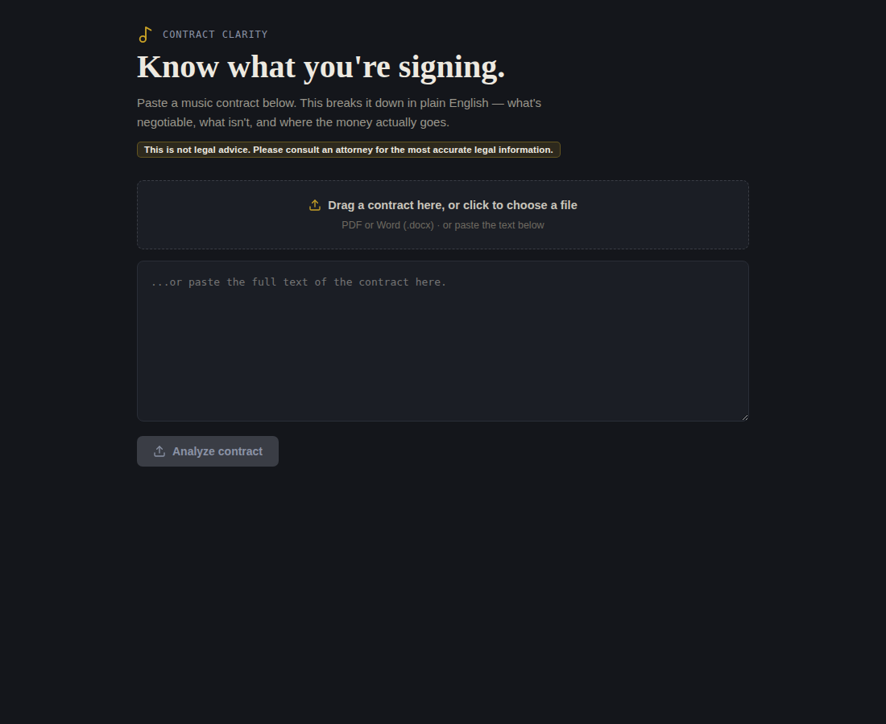

# Contract Clarity

**Know what you're signing.** Contract Clarity reads music and entertainment contracts (record deals, talent agency agreements, likeness releases, management deals and similar) and explains them in plain English for artists who aren't lawyers: what each clause does, how much long-term harm it could cause, how negotiable it usually is, and where the money goes.



> **This is not legal advice.** Contract Clarity is an educational tool. Talk to an attorney licensed in your contract's governing-law state before signing anything.

## What it does

- **Add one contract or several that go together.** Drop PDF or Word (.docx) files anywhere on the page, or paste text. Nothing is read until you click **Analyze contract** (or **Analyze contracts** when there's more than one). PDFs keep their page numbers, so findings can cite pages.
- **Clause-by-clause breakdown** across the terms that matter in entertainment deals: commission and compensation, fees and repayment, advances, recoupment and set-off, exclusivity, publishing, ownership of the artist's materials, merchandising, name/image/likeness, term and territory, termination, confidentiality, release of claims, disputes and arbitration, assignment, drafting problems (blank lines, missing schedules, garbled text), plus a catch-all for anything else harmful. Each clause gets:
  - a plain-English explanation
  - a harm rating (low, medium, high) and how long the effect follows the artist, scored against a fixed rubric so repeated runs stay consistent
  - a negotiability rating
  - where money is lost or withheld
  - **Works in your favor:** protective language the artist benefits from
  - **Law check:** a warning when a clause appears to depart from a statute it cites
  - the contract's own section numbers and pages, plus a **Source** button that highlights the exact language the analysis relied on
- **Redlines are read as redlines.** When a .docx carries tracked changes or comments, the tool opens the Word package itself and reads what the text extraction throws away: every deletion, every insertion, and every comment with the clause it is anchored to. A **What changed in this redline** panel then covers each material change — what the wording was, what it says now, what the change does to the artist, and the counterparty's own stated reason, quoted from their comment. This matters because a clause can read perfectly well precisely because a protection was deleted from it, and because a comment is where the counterparty states their negotiating position.
- **Figures checked by code.** Dates, blank signature and date fields, percentages, dollar amounts, years and referenced attachments are pulled out of the document by regular expressions, not by the model, and that list is handed to the model as authoritative. The model's reply is then audited against it, and any year or percentage it mentions that is not in the document is flagged as **unverified** above the breakdown. Blank date fields are reported as blank rather than guessed at — form fields in a PDF reflow when the text is extracted, which is how a model invents an approval date that was never there.
- **Conflicts between documents.** When you analyze related documents together (for example an agency agreement and a likeness release), a comparison pass flags terms that clash, such as different dispute forums. The comparison pass sees each document's clause findings and redline summary, so it cannot contradict the per-document analysis it is built on.
- **"Worth raising with an attorney"** flag on high-harm clauses.
- **Contract type, choice of law, where disputes go, and counterparty** for each document, with a closing reminder to consult an attorney licensed in that state.
- **"What other artists say."** A research pass uses web search to find how artists in that type of deal describe these terms, and the counterparty's reputation. Findings must fit the contract's actual terms, and every one carries a plain-language source tag (for example, "This is from Reddit — real people, not verified facts").
- **Copy or download** the full analysis as text.

## How it works

```
Browser (React + Vite)  ──/api──▶  Express server  ──▶  Claude API
  file reading, UI                   holds API key         1. clause analysis (per document)
  source highlighting                and prompts           2. research with web search
                                                           3. conflicts between documents
```

The API key never reaches the browser. The server holds it and makes every call.

## Run it locally

You need Node.js 18 or newer and an [Anthropic API key](https://console.anthropic.com/). Each document takes two API calls (plus one comparison call when you analyze several together), and the research call uses web search, which is billed per search. Set a spend limit in the console while testing.

```bash
git clone <this repo>
cd <this repo>
npm run setup            # installs server and client dependencies
cp .env.example .env     # then put your API key in .env
npm run dev
```

Open the URL Vite prints (usually http://localhost:5173). The backend runs on port 3001.

## Project layout

```
server/server.js                 Express backend: /api/analyze, /api/research, /api/conflicts
server/prompts.js                The prompts sent to Claude, including the rating rubric
server/docfacts.js               Pulls dates, amounts and blanks out of the text by code; audits the reply
server/markup.js                 Renders tracked changes and comments into the prompt
client/src/markup.js             Reads tracked changes and comments out of the .docx package
client/src/ContractClarity.jsx   The whole front end
docs/BUILD-SPEC.md               Original notes for moving from a Claude artifact to a local app
```

## Known limits

- Scanned or photographed PDFs have no extractable text. Paste the text instead.
- Word files and pasted text have no fixed pages, so only PDFs get page citations.
- Section references depend on the contract's own numbering.
- Source highlighting is fuzzy-matched and can miss on badly formatted documents. The tool says so when it can't find the spot.
- Only the first 60,000 characters of each contract are analyzed.
- Tracked changes and comments are read from .docx files only. A PDF of a redline shows the markup as pictures, with no change data to read.
- Ratings follow a fixed rubric but come from a language model, so they can still vary slightly between runs.

## License

[GNU Affero General Public License v3.0](LICENSE). You may use, study, and modify this code. If you run a modified version as a network service, you must make your source available to its users.
